<!-- Generated by scripts/build.py. Edit scripts/config.py, then run it. -->

  <a href="https://github.com/lidoliver"><picture><source media="(min-width: 1012px), (min-width: 600px) and (max-width: 767px)" srcset="https://raw.githubusercontent.com/lidoliver/lidoliver/main/assets/hero.svg" /></picture></a>
  <a href="https://github.com/lidoliver?tab=repositories"><picture><source media="(min-width: 1012px), (min-width: 600px) and (max-width: 767px)" srcset="https://raw.githubusercontent.com/lidoliver/lidoliver/main/assets/memory.svg" /></picture></a>
  <a href="https://github.com/lidoliver"><picture><source media="(min-width: 1012px), (min-width: 600px) and (max-width: 767px)" srcset="https://raw.githubusercontent.com/lidoliver/lidoliver/main/assets/desk.svg" /></picture></a>

Text version, with links

**Projects**

- [Gruppe11_MOB3000](https://github.com/lidoliver/Gruppe11_MOB3000): Disc golf app. I built multiplayer game sessions, the friends system and push messaging. (Kotlin · Compose · Firebase · Node)
- [ps2-install](https://github.com/lidoliver/ps2-install): Installs PS2 games onto the console's internal HDD over the network, from Linux. (Shell · Bash · C · NBD)
- [traffic-simulator](https://github.com/Vanguardium/traffic-simulator): Traffic simulation, built as a group project. (Java)
- [APP2000_G10_25](https://github.com/MarcusWHE/APP2000_G10_25): Web app built by a team of six, run with Scrum. (JavaScript · MongoDB · Express · React · Node)

**Now**

- **learning C** (C): Pointers and memory, compiled and run from Neovim with one key.
- **ps2-install** (Bash · C): A patched hdl_dump for faster installs, with KDE and Hyprland frontends.
- **PS2 modding** (OPL · MX4SIO): Games from SD card and internal HDD on real hardware.
- **this profile** (Python · SVG): A script that draws these panels, PS2 boot-screen style.

**Stack**

- Languages: Kotlin, Java, JavaScript, C, Bash
- Build: Jetpack Compose, Android, React, Node.js, Express, Firebase
- Data: PostgreSQL, MongoDB
- System: Arch Linux, Hyprland, Docker, Neovim, Git

  Drawn by <a href="https://github.com/lidoliver/lidoliver/tree/main/scripts">scripts/build.py</a>

